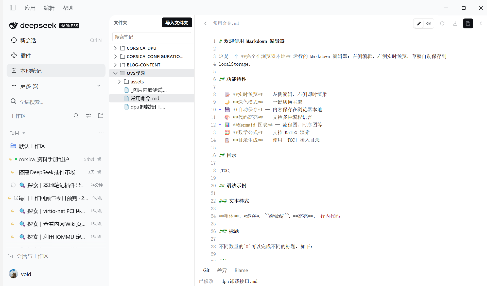
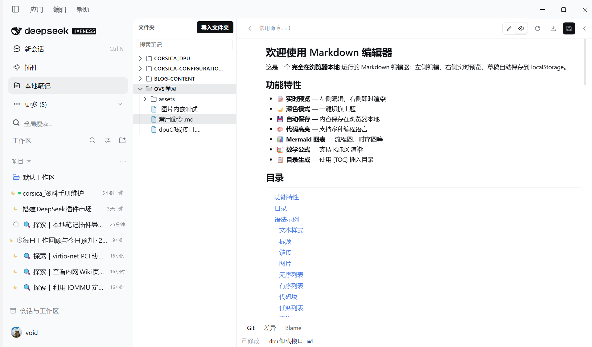
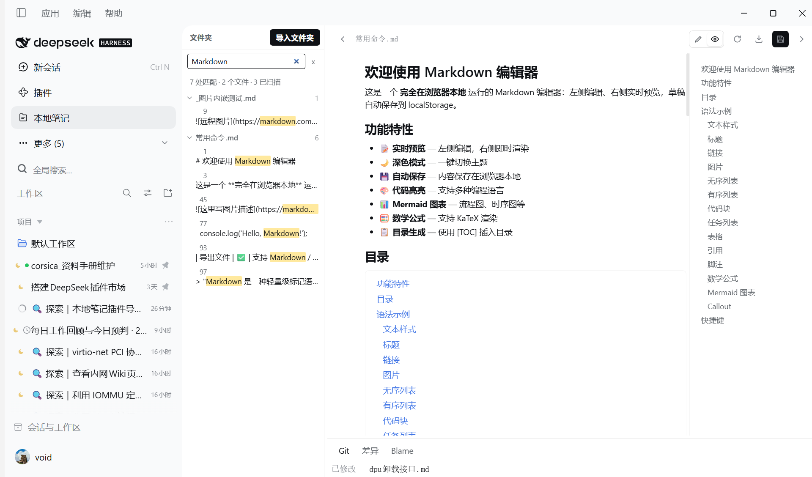
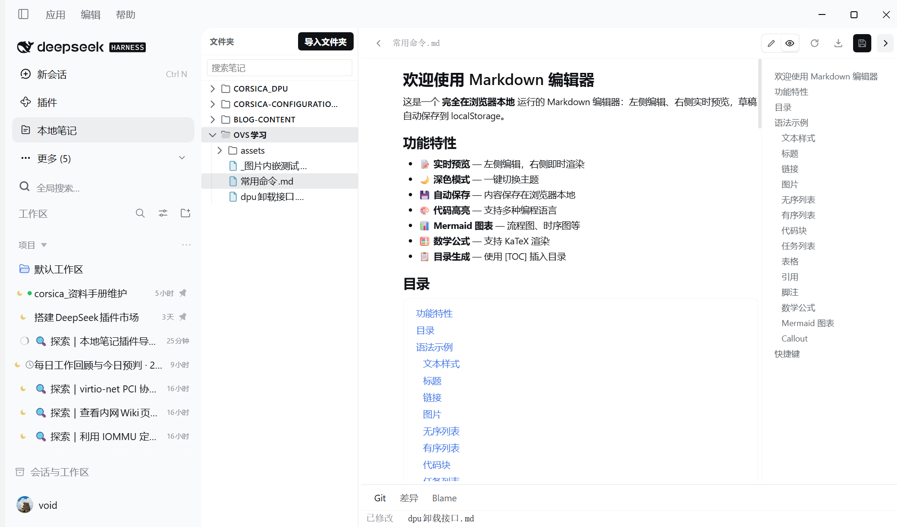
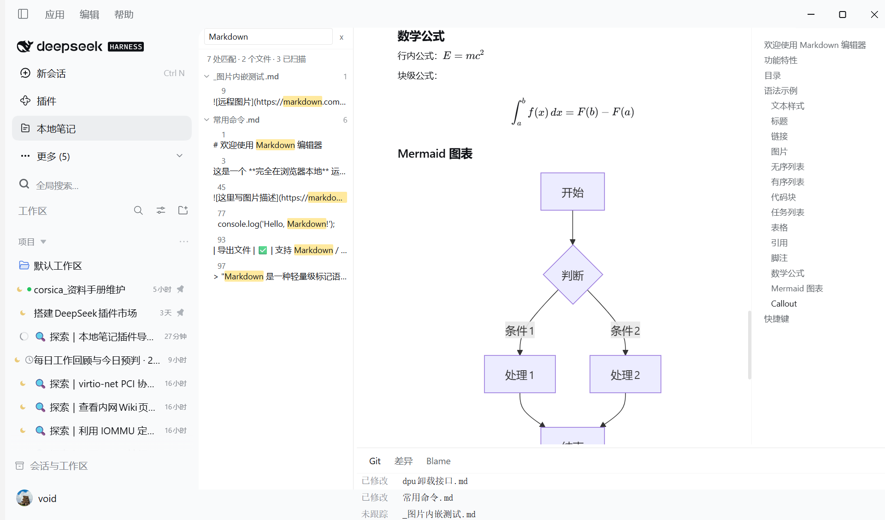

# dsh-local-markdown-notes

A [DeepSeek Harness](https://github.com/deepseek-ai) (DSH) plugin that puts a folder of Markdown
files into a sidebar panel inside the Web UI: browse the tree, read, edit with auto-save, search
the whole folder — and keep the Git context of every file in view (status, diff against `HEAD`,
per-line blame) without ever touching the repository.

The panel is local-first: files stay where they are on disk, nothing is copied, synced or uploaded.



## Features

- **Folder panel** — import any number of local folders (a Git repo or a plain directory); a
  recursive tree lists every Markdown file, one click opens it next to the conversation.
- **Edit with auto-save** — the editor saves while you type, and keystrokes typed while a save is
  already in flight are not dropped (they are re-sent after the write settles).
- **Markdown rendering** — headings, tables, lists, task lists, links, images, footnotes, callouts
  (`> [!NOTE]`), strikethrough and fenced code blocks with syntax highlighting (shell,
  PowerShell, Python, JavaScript/TypeScript, Go, Rust, Java, C/C++, SQL, JSON, YAML and more).
- **Outline beside the preview** — every heading is listed down the right edge and jumps to its
  section on click; a `[TOC]` line renders the same list inline.
- **Maths and diagrams, offline** — `$…$` and `$$…$$` are typeset with a bundled KaTeX, and
  ` ```mermaid ` fences are drawn with a bundled Mermaid. Both ship inside the plugin as lazy
  chunks, so the preview works with no network at all.
- **Read-only Git context** — a file's status against `HEAD`, a diff with per-line change bars,
  and line blame for the current file. The plugin only runs `git status`, `git diff` and
  `git blame`; it never commits, stages, checks out or rewrites history.
- **Search across folders** — full-text search over every imported folder, with the hit list
  jumping straight to the matching line.
- **Agent tools** — the same content is available to the model through six tools:
  `notes_projects`, `notes_list`, `notes_read`, `notes_write`, `notes_append`, `notes_search`.

## Screenshots

| Preview, outline on the right | Search across every imported folder |
| --- | --- |
|  |  |

| Outline rail for a long document | Maths and diagrams, typeset offline |
| --- | --- |
|  |  |

## Install

```bash
# from GitHub (recommended while the package is not on npm)
dsh plugin --profile <your-profile> add github:sisyphus1212/dsh-local-markdown-notes
```

Then restart the app and its host (**Help → Restart App and Host**). A page reload is not enough:
plugin bundles are rebuilt only when the application and the host process restart together.

Manual install: copy this directory into
`~/.dsh/profiles/<your-profile>/node_modules/@local/local-markdown-notes` and make sure
`dsh.profile.bundles` in that profile's `package.json` lists `@local/local-markdown-notes`.

## Usage

1. Open the **Local Markdown Notes** panel from the sidebar.
2. Add a folder — any directory with Markdown files; if it is a Git repository the Git features
   light up automatically, otherwise the editor and search still work.
3. Pick a file, edit it, and use the search box to find text across every imported folder.

## Requirements

- DSH with Cordis 4.x (`@deepseek-ai/cordis ^4.0.1`).
- `git` on `PATH` for the status/diff/blame features (optional — the panel works without it).

## How it is built

- Host half — `index.js` and `lib/*.js`: registers the six tools and a storage domain through the
  host's existing `dsh-storage-domain` service. It deliberately does **not** mount its own storage
  stack (mounting a second `domain` storage throws `storage form 'domain' is already mounted` and
  takes the whole app down).
- Browser half — `client.js`: prebuilt and committed, declared through `dsh.client` in
  `package.json`. The two heavy engines ride along as package-local lazy chunks
  (`client.katex.js`, `client.mermaid.js`): they register through the host's module loader and are
  fetched only when a note actually contains a formula or a diagram.
- `package.json` declares `dsh.bundle.patch` → `cordis.patch.yml`, which inserts exactly one row
  (this plugin) and nothing else.

## 中文简介

把本机的 Markdown 文件夹做成 DSH 侧边栏里的笔记面板：树形浏览、就地编辑（自动保存）、全文检索，
并在不改动仓库的前提下显示 Git 状态、与 `HEAD` 的差异（逐行变更标记）和逐行 blame。
预览支持脚注、Callout、任务列表、图片、删除线、表格对齐；右侧列出全文目录（点条目跳转），
文档里写 `[TOC]` 会在原位生成同样的目录；公式用内置 KaTeX 排版、```mermaid 图用内置 Mermaid 绘制，
两者作为懒加载 chunk 随插件离线可用。
插件同时向模型提供 `notes_*` 六个工具，因此对话里也能直接读写这些笔记。

安装：`dsh plugin --profile <profile> add github:sisyphus1212/dsh-local-markdown-notes`，
然后「帮助 → 重启应用与 Host」。
